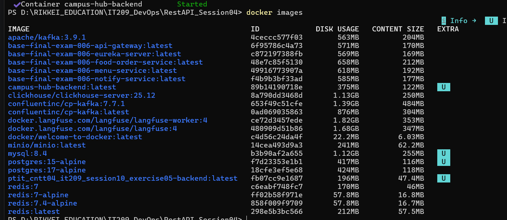
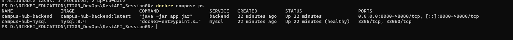
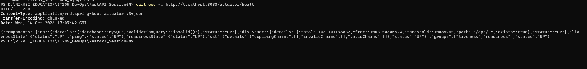

# Campus Hub — Docker & Docker Compose

## 1. Thông tin sinh viên

- **Họ và tên:** Nguyễn Văn Ánh
- **Mã sinh viên:** B24DTCN076
- **Môn học:** IT209 — DevOps

## 2. Giới thiệu

Đóng gói backend Campus Hub thành Docker Image và sử dụng Docker Compose để chạy backend cùng MySQL.

Các thành phần sử dụng:
- Java và Gradle
- Spring Boot
- Docker và Docker Compose
- MySQL 8.4

## 3. Cấu trúc dự án

```text
RestAPI_Session04/
├── Dockerfile
├── .dockerignore
├── compose.yml
├── README.md
├── gradlew
├── gradlew.bat
├── gradle/
├── src/
└── screenshots/
    ├── 01-docker-images.png
    ├── 02-docker-compose-ps.png
    └── 03-actuator-health.png
```

## 4. Kiểm thử backend bằng Gradle

Chạy lệnh trên Windows PowerShell:

```powershell
.\gradlew.bat test
```

Kết quả kiểm thử: `BUILD SUCCESSFUL`.

## 5. Build và chạy ứng dụng

Khởi động Docker Desktop trước, sau đó mở PowerShell tại thư mục dự án và chạy:

```powershell
docker compose up -d --build
```

Kiểm tra Docker Image:

```powershell
docker images
```

Kiểm tra cấu hình Compose:

```powershell
docker compose config
```

Kiểm tra trạng thái các service:

```powershell
docker compose ps
```

Dừng các service khi cần:

```powershell
docker compose down
```

## 6. Kiến trúc kết nối

Docker Compose khởi chạy hai service:

- **backend:** ứng dụng Campus Hub, công khai cổng `8080`.
- **mysql:** MySQL 8.4, sử dụng volume `mysql-data` để lưu dữ liệu.

Backend kết nối đến MySQL thông qua tên service `mysql` và cổng nội bộ `3306`, không sử dụng `localhost` trong chuỗi kết nối giữa hai container.

## 7. Kiểm tra sức khỏe API

URL kiểm tra:

http://localhost:8080/actuator/health

Lệnh kiểm tra trên Windows PowerShell:

```powershell
curl.exe -i http://localhost:8080/actuator/health
```

Kết quả xác nhận:
- HTTP status: `200`
- Trạng thái tổng thể: `UP`
- Trạng thái kết nối database: `UP`

## 8. Ảnh minh chứng

### Ảnh 1 — Docker Image đã build thành công



### Ảnh 2 — Trạng thái Docker Compose



### Ảnh 3 — Kết quả Actuator Health


